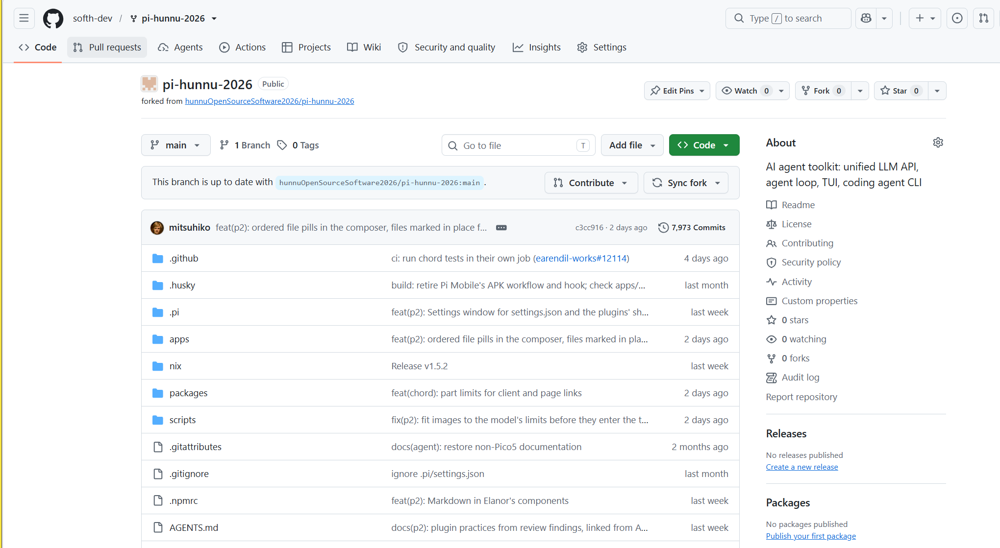
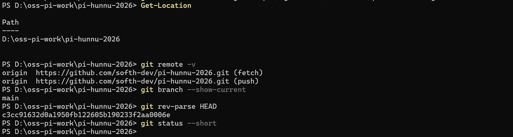
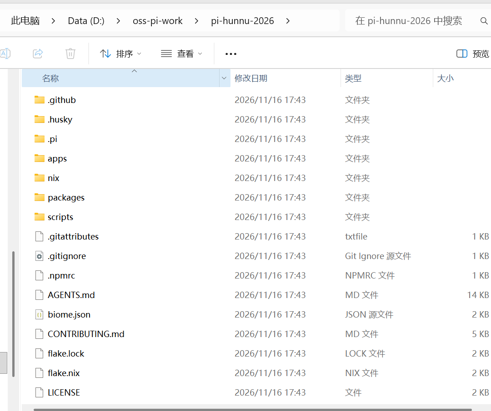
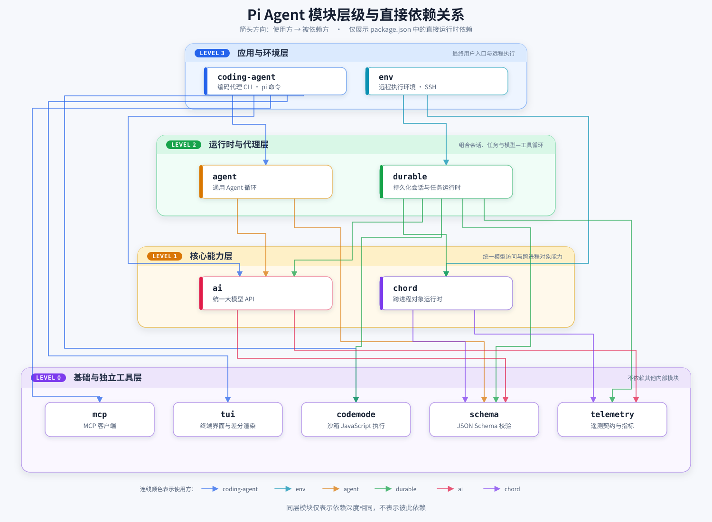

# 实践课 2：组织建仓与 Pi Agent 源码分析实践报告

## 基本信息

| 项目 | 内容 |
|---|---|
| 姓名 | 杨欣华 |
| 学号 | 202430224022 |
| GitHub 登录名 | faw-k123 |
| 所在小组 | 组织：`softh-dev` |
| 分析所用提交 | `c3cc91632d0a1950fb122605b190233f2aa0006e` |
| 本人重点分析模块 | `durable`、`coding-agent`、`ai`、`agent` |

---

## 一、小组组织仓库（任务一）

本组代码仓库由组长从课程仓库 fork 建立：

- 小组组织：`softh-dev`
- 小组仓库：<https://github.com/softh-dev/pi-hunnu-2026>
- fork 来源：`hunnuOpenSourceSoftware2026/pi-hunnu-2026`
- 小组成员具有后续开发所需的仓库访问权限

组织仓库页面截图：



## 二、源码获取（任务二）

### 2.1 下载源码

在 `D:\oss-pi-work` 下执行：

```powershell
git clone --branch main https://github.com/softh-dev/pi-hunnu-2026.git
cd pi-hunnu-2026
```

实际 clone 地址（文本）：**https://github.com/softh-dev/pi-hunnu-2026.git**

### 2.2 确认源码来源和版本
截图 S1（当前目录、远端地址、分支、提交编号和工作区状态）：


| 命令 | 实际输出 | 结论 |
|---|---|---|
| `Get-Location` | `D:\oss-pi-work\pi-hunnu-2026` | 源码已下载到本地 |
| `git remote -v` | `origin https://github.com/softh-dev/pi-hunnu-2026.git`（fetch/push） | origin 指向小组仓库 |
| `git branch --show-current` | `main` | 当前分支为 main |
| `git rev-parse HEAD` | `c3cc91632d0a1950fb122605b190233f2aa0006e` | 记录了完整提交编号 |
| `git status --short` | 无输出 | 截图时工作区干净 |

小组仓库：

源码目录截图：

<!--  -->

## 三、构建体系总览

根目录 `package.json` 表明该项目是一个 npm monorepo，使用 `workspaces` 管理 `packages/*`、`apps/*` 等目录。根 `build` 脚本显式进入各模块目录，按以下固定顺序执行模块自己的 `npm run build`：

```text
telemetry → schema → chord → tui → codemode → mcp
          → ai → durable → env → agent → coding-agent
```

该顺序满足内部依赖所要求的“被依赖方先构建、使用方后构建”，但还包含互不依赖模块之间的固定串行顺序。

## 四、模块分析表（任务三）

表中“直接依赖”只统计模块 `package.json` 的 `dependencies` 中、属于题目所列 11 个模块的运行时依赖。当前源码中的模块与题目清单一致。

| 子文件夹 | 代码主要实现什么功能 | 本模块 build 执行什么、生成什么 | 直接依赖哪些内部模块 | 依据文件或代码位置 |
|---|---|---|---|---|
| `telemetry` | 提供与厂商无关的遥测契约，包括 span、事件、指标、传播、类型化遥测 schema、无操作实现和内存实现 | `tsc -p tsconfig.build.json`，把 `src` 编译到 `dist`，生成 JavaScript、`.d.ts` 及映射文件 | 无 | `packages/telemetry/package.json`、`README.md`、`src/index.ts`、`src/memory.ts` |
| `schema` | 实现无需 `eval` 的 JSON Schema 校验器，支持 Draft 2020-12 与 Draft 7，并提供 builder、格式校验、类型推断和错误解释 | `tsc -p tsconfig.build.json`，生成 `dist` 下的运行时代码和类型声明 | 无 | `packages/schema/package.json`、`README.md`、`src/compiler.ts`、`src/validator.ts` |
| `chord` | 跨进程对象运行时，覆盖契约、文档、状态、存储、链接、插件热加载、HTTP、worker、Web 和终端 surface | `tsc -p tsconfig.build.json`，将各导出子路径编译到 `dist` | `schema`、`telemetry` | `packages/chord/package.json`、`README.md`、`src/contracts/`、`src/host/`、`src/node/` |
| `tui` | 终端用户界面库，负责差分渲染、布局、键鼠输入、颜色、图片、编辑器、Markdown 和常用组件 | 普通 `build` 使用 `tsc` 生成 `dist`；原生模块由独立的 `build:native:*` 脚本构建 | 无 | `packages/tui/package.json`、`README.md`、`src/tui.ts`、`src/components/` |
| `codemode` | 在 QuickJS/WASM 沙箱内执行模型生成的 JavaScript，沙箱唯一能力是调用宿主注入的工具 | `tsc -p tsconfig.build.json`，输出入口、runtime 和 worker 的 JS 与类型声明 | 无 | `packages/codemode/package.json`、`README.md`、`src/runtime/`、`src/declarations.ts` |
| `mcp` | 独立的 Model Context Protocol 客户端，负责协议消息、客户端生命周期、传输、工具/资源调用、配置和 OAuth | `tsc -p tsconfig.build.json`，生成主入口、`oauth`、`testing` 等子路径的编译产物 | 无 | `packages/mcp/package.json`、`README.md`、`src/client.ts`、`src/transports/`、`src/oauth/` |
| `ai` | 为多家模型提供统一 LLM API，包括模型/Provider 目录、流式输出、消息与工具调用类型、认证及遥测 | 先运行 `catalog/generate.ts --strict` 生成和校验模型资料，再检查模型数据、用 `tsc` 编译，并复制 provider 数据 | `schema`、`telemetry` | `packages/ai/package.json`、`catalog/generate.ts`、`src/providers/`、`src/telemetry.ts` |
| `durable` | 持久化会话、任务和文档运行时，实现恢复、工具、code mode、压缩、子任务、hook 以及多种存储后端 | `tsc -p tsconfig.build.json`，把会话、环境和存储等多个子入口编译到 `dist` | `chord`、`ai`、`codemode`、`schema`、`telemetry` | `packages/durable/package.json`、`README.md`、`src/harness/`、`src/session/`、`src/storage/` |
| `env` | 为 Durable 提供远程执行环境，通过 SSH 部署或连接 daemon，并封装远程进程、终端、文件和监听能力 | 普通 `build` 用 `tsc` 生成 TypeScript 客户端；Rust daemon 由 `build:daemon` 单独构建 | `chord`、`durable` | `packages/env/package.json`、`README.md`、`src/remote-env.ts`、`src/ssh.ts` |
| `agent` | 通用 Agent 核心，维护状态、执行模型—工具循环、发送事件，并支持 steering、follow-up、附件和流式传输 | `tsc -p tsconfig.build.json`，生成核心 Agent API 的 JS、类型和映射文件 | `ai`、`schema` | `packages/agent/package.json`、`README.md`、`src/agent.ts`、`src/agent-loop.ts` |
| `coding-agent` | 面向用户的 Pi 编码代理 CLI，组合会话管理、read/bash/edit/write 等工具、交互/print/JSON/RPC 模式、TUI、MCP 与 code mode | 先用 `tsc` 生成未打包代码并复制资源，再由 `scripts/build-coding-agent-bundle.mjs` 使用 esbuild 生成 CLI、SDK、RPC 和 worker bundle | `agent`、`ai`、`codemode`、`mcp`、`tui` | `packages/coding-agent/package.json`、`src/main.ts`、`src/core/`、`src/modes/`、`scripts/build-coding-agent-bundle.mjs` |

## 五、模块层级与依赖关系图

下图包含题目要求的 11 个模块。箭头统一表示 **使用方 → 被依赖方**；所有边均来自各模块 `package.json` 的 `dependencies`，没有混入开发依赖或可选依赖。



可编辑图源：[deps.mmd](deps.mmd)。

层级划分依据：

1. 第 0 层是不依赖其他内部模块的基础能力：`telemetry`、`schema`、`tui`、`codemode`、`mcp`。
2. 第 1 层直接组合基础能力：`chord`、`ai`。
3. 第 2 层组合第 1 层能力形成运行时或 Agent 循环：`durable`、`agent`。
4. 第 3 层是用户入口或远程环境实现：`coding-agent`、`env`。

## 六、三个问题的回答

### 1. 根目录与子模块中的 `npm run build` 分别读取什么配置、执行什么工作？

根目录执行 `npm run build` 时，npm 首先读取根 `package.json` 的 `scripts.build`。该脚本不直接编译整个 workspace，而是依次 `cd packages/<模块>`，再触发模块自己的 `npm run build`。

多数模块的 build 都是 `tsc -p tsconfig.build.json`。模块配置继承根 `tsconfig.base.json` 中的公共规则，例如 ES2024 目标、Node16 模块解析、严格类型检查、生成声明文件、声明映射和源码映射；模块自身再指定 `rootDir: src`、`outDir: dist`、包含范围和内部包类型路径。

两个模块有额外步骤：`ai` 在编译前生成并校验模型目录，编译后复制 provider 数据；`coding-agent` 在 TypeScript 编译和资源复制后，再用 esbuild 生成可发布的 CLI/SDK/RPC bundle 及 worker 文件。普通 `tui build` 不编译原生扩展，普通 `env build` 也不构建 Rust daemon，它们分别有独立脚本。

### 2. 构建顺序和模块依赖有什么关系？相邻构建的模块是否一定互相依赖？

根构建顺序是依赖关系的一种拓扑排序：如果模块需要内部依赖的 `dist` 类型或运行时代码，被依赖模块必须先完成构建。例如 `durable` 位于 `chord`、`ai`、`codemode`、`schema` 和 `telemetry` 之后；`coding-agent` 依赖多个上层模块，因此被放在最后。

相邻模块不一定互相依赖。`telemetry` 和 `schema` 相邻但互不依赖；`chord` 和 `tui` 相邻但不存在依赖边；`codemode` 与 `mcp` 也互不依赖。依赖只规定“谁不能排在谁之前”，根脚本再从多个合法拓扑顺序中选取一个固定串行顺序。

### 3. 选择一条涉及至少三个模块的依赖路径，说明这些模块如何分工。

选择路径：

```text
coding-agent → agent → ai → telemetry
```

- `coding-agent` 是外层产品入口，解析 CLI 参数、管理交互/RPC 等模式和会话，并把用户输入交给 Agent。
- `agent` 负责通用模型—工具循环和状态、事件控制，不关心具体的 CLI 界面。
- `ai` 屏蔽不同模型供应商的协议差异，负责模型选择、消息转换、流式请求和工具调用数据。
- `telemetry` 提供与厂商无关的 span 和指标契约，使模型请求可被观测，同时避免把上层绑定到特定遥测后端。

这条路径体现了从具体应用入口，到通用 Agent 控制，再到模型访问和基础观测的逐层分工。

## 七、本人重点分析的模块

### 7.1 `durable`

`durable` 的职责不只是“保存聊天记录”，而是把会话、任务、文档和工具执行组织成能够恢复的运行时。`src/harness/` 负责模型生成、压缩和上下文组织；`src/session/` 负责会话状态、分叉和缓存；`src/storage/` 提供 memory、JSONL、SQLite、IndexedDB 等不同存储实现；`src/codemode/` 和 `src/tool-search/` 把沙箱代码执行和工具发现接入会话。它直接依赖五个内部模块，是把底层能力组合成长期运行任务的关键中间层。

### 7.2 `coding-agent`

`coding-agent` 是最终的 `pi` CLI 产品层。`src/cli/` 负责命令行解析和登录等命令，`src/core/` 负责会话、认证、模型配置和工具，`src/modes/` 提供 interactive、print、JSON、RPC 等运行模式，`src/extensions/` 接入 MCP、code mode 和工具搜索。它的构建也最特殊：先生成普通 `dist` 代码，再用 esbuild 把入口、懒加载模块和 worker 打包，说明最终 CLI 与普通库模块在分发方式上有明显差异。

### 7.3 `ai`

`ai` 位于模型供应商和上层 Agent 之间，负责把不同厂商的大模型接口统一成一套 API。`src/api/` 中包含 Anthropic Messages、OpenAI Responses、Google Generative AI、Bedrock Converse 等协议实现；`src/providers/` 保存供应商定义和模型资料；`src/auth/` 与 `src/oauth.ts` 负责登录和凭据流程；`src/types.ts`、`src/models.ts` 定义统一的消息、模型、工具调用、流式事件和用量类型。上层模块因此不需要分别适配每一家模型供应商。

该模块直接依赖 `schema` 和 `telemetry`。`schema` 用于结构化数据及工具参数校验，`telemetry` 用于记录模型请求的 span、状态、用量和错误。它的构建过程也不同于普通 TypeScript 库：`npm run build` 先执行 `catalog/generate.ts --strict`，根据 `catalog/` 中的定义生成并校验模型目录；随后执行 `build:offline`，检查模型数据、使用 `tsc` 编译，并将 provider 数据复制到 `dist/providers`。这说明模型目录是由定义文件生成并在构建阶段检查一致性的，而不是随意维护的静态列表。

### 7.4 `agent`

`agent` 提供与具体界面和应用场景无关的通用 Agent 核心。`src/agent.ts` 中的 `Agent` 类负责保存状态、接收 prompt、继续会话、处理中断和排队输入；`src/agent-loop.ts` 实现模型调用与工具执行之间的循环：模型产生工具调用后执行对应工具，把工具结果加入上下文，再继续请求模型；`src/types.ts` 定义 Agent 消息、工具、事件、状态和配置；`src/proxy.ts` 为跨边界调用提供代理支持。

该模块直接依赖 `ai` 和 `schema`。`ai` 提供模型、消息、流式响应和工具调用能力，`schema` 提供工具参数的类型与结构描述。`agent` 本身不处理终端界面、文件操作或具体供应商登录，因此能被 `coding-agent` 等不同应用复用。它的 `build` 使用 `tsc -p tsconfig.build.json` 生成 JavaScript 和类型声明；`tsconfig.build.json` 还把 `pi-ai` 的类型路径指向 `../ai/dist`，这也是根构建顺序必须先构建 `ai`、再构建 `agent` 的直接依据。

## 八、心得体会

这次分析让我学会了从构建脚本反推项目架构。根 `package.json` 中看似重复的 `cd` 和 `npm run build`，与各模块的 `dependencies` 对照后，实际形成了一条合法的拓扑顺序。继续阅读各模块的入口文件和 README，可以看到项目把 schema、telemetry 等基础契约放在底层，把模型访问和跨进程对象能力放在中间，再由 durable、agent 和 coding-agent 逐层组合为最终产品。这种拆分既降低了模块耦合，也让独立能力可以被其他应用复用。
