# 实践课 3：Pi Agent 源码获取、依赖安装与本地编译实践报告

## 基本信息

| 项目 | 内容 |
|---|---|
| 姓名 | 杨欣华 |
| 学号 | 202430224022 |
| GitHub 登录名 |faw-k123 |
| 本地源码目录 | 'https://github.com/softh-dev/pi-hunnu-2026'|
| 构建所用提交 | `c3cc91632d0a1950fb122605b190233f2aa0006e` |
| 实测 Node / npm / Git 版本 | v24.18.0 / 11.16.0 / 2.55.0.windows.5 |

> 说明：本次不要求构建独立 EXE，也不要求部署大模型权重。

---

## 一、实验准备：检查和安装开发工具（任务一）

### 1.1 检查现有环境

在 PowerShell 中执行：

```powershell
node --version
npm --version
git --version
```

| 工具 | 实际版本 | 是否满足要求 |
|---|---|---|
| Node.js | v24.18.0 | 满足根项目 `engines.node` 的 `>=22.19.0`，且属于课程建议的 Node 24 LTS |
| npm | 11.16.0 | 随 Node.js 一同安装，可直接用于安装依赖和执行脚本 |
| Git | 2.55.0.windows.5 | 满足下载与版本管理需要 |

截图 S1（三条版本命令的输出）：

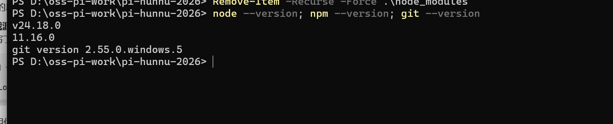

*图 1 本机 Node.js v24.18.0、npm 11.16.0、Git 2.55.0.windows.5；*

### 1.2 对照版本要求

- 根项目 `engines.node` 要求：`>=22.19.0`（见第三节截图的第 69–71 行）。
- 本机 Node.js 是否满足：满足，v24.18.0 高于最低要求，并且安装日志中没有出现 `EBADENGINE` 警告。
- 是否需要安装或切换版本：不需要，因此本次未安装或切换 Node.js。

### 1.3 需要安装或切换 Node.js 时

本机已满足版本要求，未执行安装或切换。

> 供参考：若需升级，可从 Node.js 官网选择课程建议的 LTS 版本下载 Windows Installer（`.msi`），保留 Node.js runtime、npm 和 Add to PATH；使用 fnm 的话可执行 `fnm install <版本>`、`fnm use <版本>`、`fnm default <版本>`，再用 `node -e "console.log('Hello, Node.js!')"` 复核。

---

## 二、下载课程仓库源码（任务二）

> 「上次实践已做略过，为了教学过程完整，此步骤保留」。

### 2.1 下载源码（已做过可略过）

本次处理方式：复用第二次实践已经下载到 `D:\oss-pi-work\pi-hunnu-2026` 的仓库，没有重新 clone，也没有删除或覆盖原目录。

实际使用的来源地址（文本）：【待填写】

### 2.2 确认源码来源和版本

在仓库根目录执行：

```powershell
Get-Location
git remote -v
git branch --show-current
git rev-parse HEAD
git status --short
```

| 命令 | 实际输出 | 结论 |
|---|---|---|
| `Get-Location` | `D:\oss-pi-work\pi-hunnu-2026` | 源码位于本机实验目录 |
| `git remote -v` | `origin https://github.com/softh-dev/pi-hunnu-2026.git`（fetch 与 push 各一条） | origin 指向小组组织内的 fork 仓库 |
| `git branch --show-current` | `main` | 当前分支为 main |
| `git rev-parse HEAD` | `c3cc91632d0a1950fb122605b190233f2aa0006e` | 已记录完整提交编号 |
| `git status --short` | 无输出 | 截图时工作区干净，没有未提交改动 |

截图 S2（当前目录、远端地址、分支、提交编号和工作区状态）：

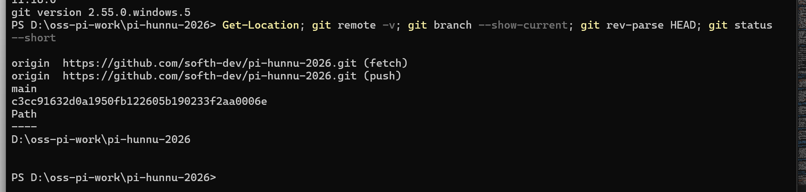

*图 2 origin 指向小组仓库 `softh-dev/pi-hunnu-2026`，分支 main，HEAD 为 `c3cc916…0006e`，`git status --short` 无输出；图中 `Path` 表格排在 git 命令之后，是 PowerShell 对表格对象延后格式化的结果，不代表命令执行顺序。*

---

## 三、阅读配置，确认安装与编译的依据（任务三）

### 3.1 `README.md` 的 `Development` 小节

该小节提供的开发命令：

| 命令 | 说明 |
|---|---|
| `npm install --ignore-scripts` | 安装全部依赖，但不执行生命周期脚本 |
| `npm run build` | 先刷新模型数据，再构建所有包 |
| `npm run build:offline` | 复用已有模型数据重建，不访问网络 |
| `npm run check` | Lint、格式化与类型检查 |
| `./test.sh` | 运行测试（无 API Key 时跳过依赖模型的测试） |
| `./pi-test.sh` | 直接从源码运行 pi，可在任意目录执行 |

截图 S3-1（README 的 Development 小节）：

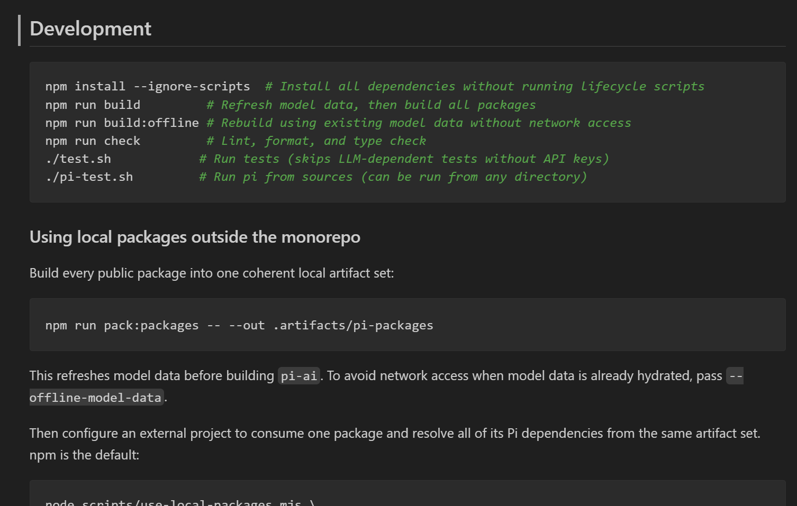

*图 3 README 的 Development 小节列出了安装、构建、离线重建、检查、测试和从源码运行 pi 的命令。*

### 3.2 根 `package.json`

| 观察项 | 实际内容 |
|---|---|
| `engines` | `"node": ">=22.19.0"`（根 `package.json` 第 69–71 行，同一文件 `version` 为 `0.0.3`） |
| `workspaces` | 六个条目：`packages/*`、`apps/*`、`packages/chord/test/examples/61-tutorial`、`packages/coding-agent/examples/extensions/with-deps`、`packages/coding-agent/examples/extensions/custom-provider-anthropic`、`packages/coding-agent/examples/extensions/gondolin` |
| `scripts.build` | 根 `package.json` 的 `build` 脚本：用 `&&` 依次 `cd` 进入 11 个包并执行各自的 `npm run build`，顺序为 telemetry → schema → chord → tui → codemode → mcp → ai → durable → env → agent → coding-agent，前一步失败则中止（完整命令见下方代码块与图 6） |
| `devDependencies` 中与构建相关的工具 | `typescript 7.0.2`、`esbuild 0.28.2`、`@biomejs/biome 2.3.5`（另有 `@biomejs/wasm-nodejs 2.3.5`）、`@types/node 22.19.19`、`husky 9.1.7`、`yaml 2.9.0`、`pnpm 11.15.1` |

根 `package.json` 中 `scripts.build` 的完整原文：

```json
"build": "cd packages/telemetry && npm run build && cd ../schema && npm run build && cd ../chord && npm run build && cd ../tui && npm run build && cd ../codemode && npm run build && cd ../mcp && npm run build && cd ../ai && npm run build && cd ../durable && npm run build && cd ../env && npm run build && cd ../agent && npm run build && cd ../coding-agent && npm run build"
```

这条命令本身不编译代码：它只是按固定顺序进入 11 个包目录并触发每个包自己的 `npm run build`，`&&` 保证前一步成功后才继续。

截图 S3-2（根 `package.json` 的 `engines.node`）：

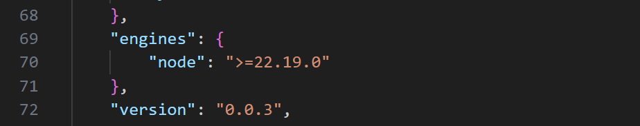

*图 4 根 `package.json` 第 69–71 行声明 `engines.node` 为 `>=22.19.0`，第 72 行 `version` 为 `0.0.3`。*

截图 S3-3（根 `package.json` 的 `workspaces`）：

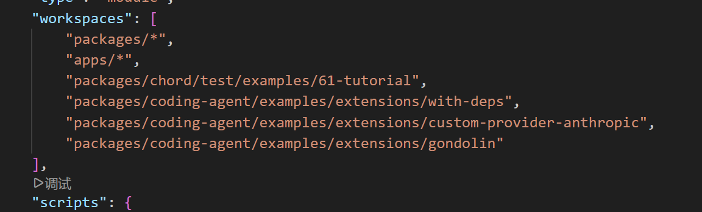

*图 5 `workspaces` 共六个条目：`packages/*`、`apps/*` 覆盖主要工作区，另外四个条目把示例目录（`chord` 教程与 `coding-agent` 的三个扩展示例）也注册为工作区；图中下方 `"scripts": {` 刚开始，未包含 `build` 内容。*

截图 S3-4（根 `package.json` 的 `scripts.build`）：

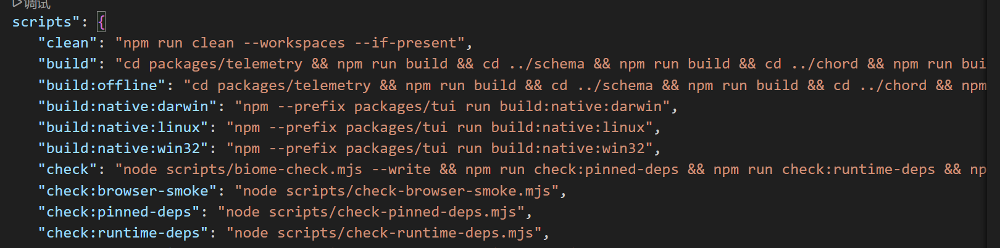

*图 6 `scripts` 中的 `build` 字段，右端被编辑器窗口截断（仅显示到 `&& npm run bui`），完整命令以 3.2 的代码块为准；同图可见 `clean`、`build:offline`、`build:native:*` 与多个 `check:*` 脚本。*

### 3.3 `package-lock.json`

该文件是依赖版本的唯一依据：`package.json` 只声明版本范围，而 `package-lock.json` 记录了每个直接依赖与间接依赖的确切版本、下载地址和依赖树结构。`npm install` 时会优先按锁文件安装，使不同机器和 CI 装出同一套依赖，避免依赖被自动升级到新版本后导致构建结果不一致；因此依赖发生变化时，应同步更新该文件，而不是删除或忽略它。

### 3.4 `packages/coding-agent/package.json`

| 观察项 | 实际内容 |
|---|---|
| `bin` 入口 | `"pi": "dist/bundle/cli.js"`，即安装或链接后 `pi` 命令运行的是打包后的 CLI bundle；同一文件还声明 `main: ./dist/index.js`、`types: ./dist/index.d.ts` 和 `piConfig.configDir: .pi` |
| `scripts.build` 做了什么 | 从构建日志可见先执行 `build:unbundled`：`tsc -p tsconfig.build.json && node ../../scripts/package-files.mjs executable dist/cli.js dist/rpc-entry.js && npm run copy-assets`，随后再打包，最终输出 `Built packages\coding-agent\dist\bundle (84 files, 9.4 MiB)` |

### 3.5 本节需要回答的问题

1. Node.js 版本要求写在哪里？
   写在仓库根目录 `package.json` 的 `engines.node` 字段里，值为 `>=22.19.0`（图中第 69–71 行）。
2. `npm run build` 实际从哪里读取命令？
   npm 读取根 `package.json` 的 `scripts.build` 字段；该字段并不直接编译代码，而是用 `&&` 依次 `cd` 到各子包并触发子包自己的 `npm run build`，子包再由各自的 `scripts.build` 决定具体执行 `tsc`、生成模型数据或打包。

---

## 四、安装项目依赖（任务四）

### 4.1 执行安装

确认当前目录包含根 `package.json` 后执行：

```powershell
npm install --ignore-scripts
echo "EXITCODE=$LASTEXITCODE"
```

该命令完成的工作：按 `package.json` 与 `package-lock.json` 解析并下载依赖，在仓库根目录建立 `node_modules` 并关联 `packages/*`、`apps/*` 等工作区本地包，同时装上 TypeScript、esbuild 等构建工具；`--ignore-scripts` 跳过 `postinstall`、`prepare` 等生命周期脚本，但不会影响之后主动执行的 `npm run build`。命令没有 `-g`，因此只安装当前项目依赖，不会把本地源码装成全局 `pi`。

### 4.2 安装输出分析

| 观察项 | 实际情况 |
|---|---|
| 退出码 | `EXITCODE=0`，安装成功 |
| 安装统计 | `added 326 packages, changed 5 packages, and audited 356 packages in 2m` |
| `EBADENGINE` 警告 | 没有出现 |
| 其他 `npm warn` | `Unknown project config "min-release-age-exclude"`，属 npm 配置项提示，与依赖本身无关 |
| `deprecated` 提示 | `prebuild-install@7.1.3`（不再维护）、`node-domexception@1.0.0`（建议改用平台原生 DOMException），均为提示，不影响安装结果 |
| `vulnerabilities` 审计结果 | `found 0 vulnerabilities` |
| `funding` 提示 | `57 packages are looking for funding`，并提示可用 `npm fund` 查看赞助者，属信息提示 |
| `npm notice`（新主版本） | `New major version of npm available! 11.16.0 → 12.2.3`，并给出更新说明链接与 `npm install -g npm@12.2.3` 建议。这只是版本通告：不是错误，不影响本次安装结果；本次仍使用 11.16.0，与课程文档记录的版本保持一致，未执行全局升级，以免工具链与文档不一致 |

截图中的提示可归为四类：配置提示（`Unknown project config`）、弃用提示（`deprecated`）、结果统计（`added/changed` 与 `audited` 条数、`funding`、`vulnerabilities`）、版本通告（`npm notice` 新主版本）。四类都属于提示而非错误，判断安装是否成功应看退出码与是否出现 `npm ERR!`：本次退出码为 0，没有出现错误，因此安装成功；`found 0 vulnerabilities` 只表示该次审计未报告已知漏洞，也不是构建成功的证明。

截图 S4（安装结果与退出码）：

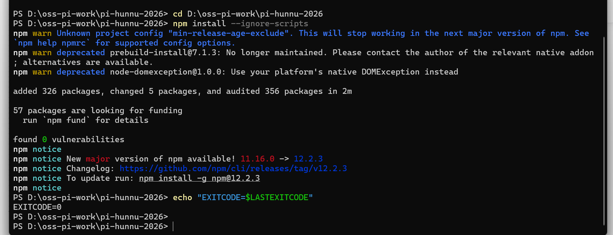

*图 7 `npm install --ignore-scripts` 完成，退出码 0，`found 0 vulnerabilities`，警告只有弃用与 npm 配置提示。*

---

## 五、本地编译与构建产物验证（任务五）

### 5.1 首次构建

仍在仓库根目录执行：

```powershell
npm run build
echo "EXITCODE=$LASTEXITCODE"
```

构建过程观察：

- 根脚本先被展开为 `cd packages/telemetry && npm run build && cd ../schema && …` 的串行链，日志中依次出现 `@earendil-works/pi-telemetry@1.5.2 build`、`…pi-schema…` 等各包的构建输出。
- `ai` 包阶段先输出了模型目录统计：`Total tool-capable models: 1695`、`Reasoning-capable models: 1457`，并逐条列出各 provider（如 amazon-bedrock 208、anthropic 18、google 26、openai-codex 8 等）的 chat / image / classifier 模型数量，说明首次构建确实先联网生成模型目录数据。
- 最后执行 `@earendil-works/pi-coding-agent@1.5.2 build:unbundled`（`tsc` 编译、写入可执行位、`copy-assets` 复制主题、图片与 export-html 模板），再由打包脚本输出 `Built packages\coding-agent\dist\bundle (84 files, 9.4 MiB)`。

整个根构建退出码为 `0`。

截图 S5-1（构建日志，长图）：

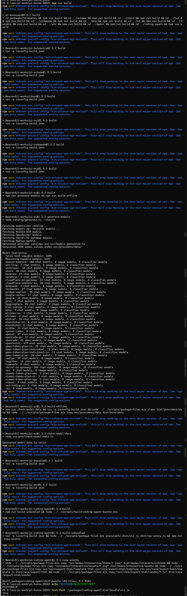

*图 8 构建日志：根脚本按 telemetry → schema → … → coding-agent 串行执行，`ai` 包输出模型目录统计，最后打包出 `dist\bundle`。*

### 5.2 检查并运行构建产物

| 验证项 | 命令 | 实际结果 |
|---|---|---|
| 整条构建链退出码 | `$LASTEXITCODE` | `0` |
| 入口文件存在 | `Test-Path .\packages\coding-agent\dist\bundle\cli.js` | `True` |
| 产物可运行 | `node .\packages\coding-agent\dist\bundle\cli.js --version` | `1.5.2` |
| 最终打包完成 | 构建日志末行 | `Built packages\coding-agent\dist\bundle (84 files, 9.4 MiB)` |

截图 S5-2（最后一段构建输出、退出码、入口文件存在与产物版本）：

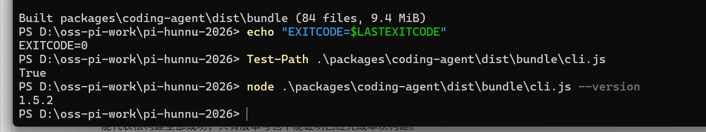

*图 9 构建以 `Built packages\coding-agent\dist\bundle (84 files, 9.4 MiB)` 结束，`EXITCODE=0`，`Test-Path` 返回 `True`，产物运行输出版本 `1.5.2`。*

> `dist` 是构建产物，后续修改应改 `src` 再重新构建；直接改 `dist` 可能在下次构建时被覆盖。

### 5.3 后续重新构建

本次首次构建已经联网生成了模型目录数据，之后没有再执行 `npm run build:offline`，所以没有单独的离线重建记录。按 README 的说明，这条命令适合模型数据已经准备好且仍然有效时的重建：它照样重新编译相关包，只是复用已有数据、不再访问网络；如果数据缺失或过期，仍要恢复网络后执行 `npm run build`。

---

## 六、启动本地源码版本并完成一次会话（任务六）

### 6.1 先验证源码入口

```powershell
.\pi-test.bat --version
```

实际输出：`1.5.2`。

### 6.2 启动交互界面

```powershell
.\pi-test.bat
```

启动情况：

- 启动界面标题显示 `v1.5.2`，与源码包版本一致。
- `[Context]` 载入了 `AGENTS.md`；`[Skills]` 列出 `add-llm-provider`、`github-work`、`interactive-testing`、`release`；`[Prompts]` 列出 `/cl`、`/deslop`、`/dup`、`/is`、`/pr`、`/sa`、`/wr`；`[Extensions]` 列出 `import-repro.ts`、`prompt-url-widget.ts`、`redraws.ts`、`tps.ts`。
- 底部状态栏显示 `0.0%/1.0M (auto)` 与模型 `deepseek-v4-pro • high`，没有出现 `/login` 提示或 `No models available`，说明复用了已有用户配置，无需重新登录。
- 顶部提示 `Update Available: New version 1.6.0 is available`，以及可用 `pi --session <id>` 恢复上次会话。

截图 S6-1（`.\pi-test.bat --version` 与启动界面）：

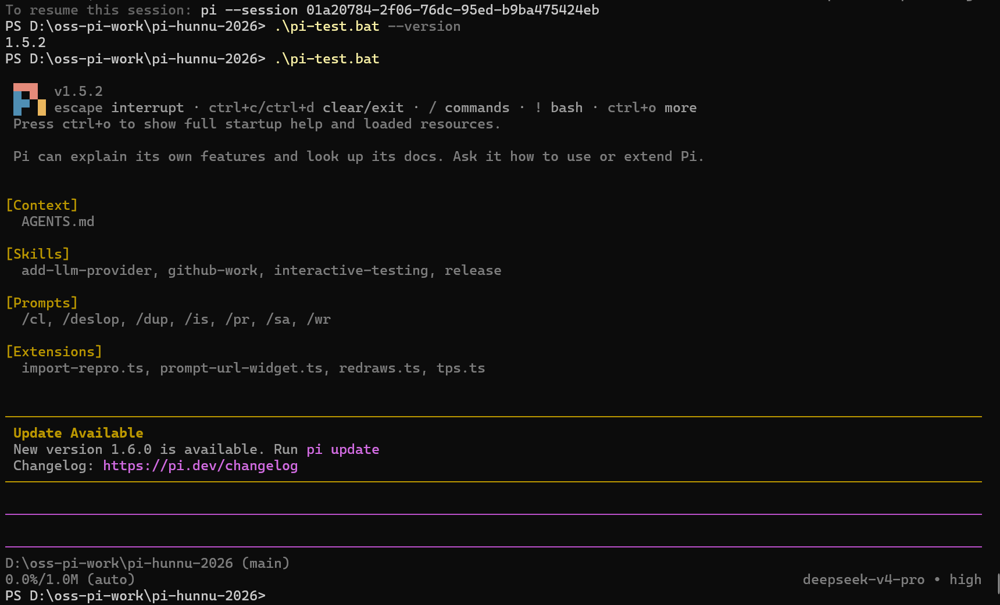

*图 10 `.\pi-test.bat --version` 输出 1.5.2；`.\pi-test.bat` 启动后界面显示 v1.5.2、已载入的 Context/Skills/Prompts/Extensions，以及当前模型 deepseek-v4-pro。*

### 6.3 完成一次会话

自己发送的提示词：

```text
请用一句话说明源码和编译产物的区别。只回答问题，不修改文件。
```

实际模型回复：

```text
源码是人可读的、描述程序逻辑的文本；编译产物是编译器将源码转换后生成的、可直接被机器执行或加载的二进制或中间代码文件。
```

回复要点：源码是可读的文本、描述程序逻辑；编译产物由编译器从源码转换而来，是可直接被机器执行或加载的二进制或中间代码文件。模型确实只回答了这一句，没有修改任何文件，符合提示词要求。状态栏显示本次用量 `↑5.3k ↓86 $0.007 0.5%/1.0M (auto)`，模型为 `deepseek-v4-pro • high`，工作目录为 `D:\oss-pi-work\pi-hunnu-2026 (main)`。

截图 S6-2（提示词与模型回复）：

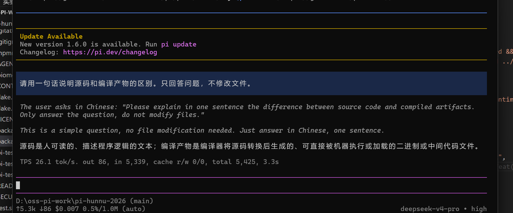

*图 11 本地源码版中发送提示词后收到一句中文回复，状态栏显示工作目录 `D:\oss-pi-work\pi-hunnu-2026 (main)` 与模型 deepseek-v4-pro。*

> 注意：不要提交 API Key、`auth.json` 或授权回调地址。

### 6.4 本节需要回答的问题

1. 本次如何确保运行的是本地源码？
   本次用 `.\pi-test.bat` 启动，该脚本转调 `pi-test.ps1`，再由 Node.js 加载源码解析器并运行 `packages/coding-agent/src/cli.ts`。三条证据说明跑的是本地源码而不是全局安装版：一是 `.\pi-test.bat --version` 与界面标题都输出 **1.5.2**，与本仓库源码包版本一致；二是本机全局安装的 `pi` 为 **1.5.0**，版本号明显不同，直接输入 `pi` 会得到 1.5.0；三是界面状态栏的工作目录为 `D:\oss-pi-work\pi-hunnu-2026 (main)`，正是刚构建的源码仓库。
2. 源码入口与 `dist/bundle/cli.js` 入口分别适合什么场景？
   源码入口是 `.\pi-test.bat` 经 `pi-test.ps1` 直接加载 `packages/coding-agent/src/cli.ts`，改完代码重新启动就能看到效果，适合开发调试和快速验证行为。`dist/bundle/cli.js` 是 esbuild 打包后的发布形态，更接近别人安装到的那个 `pi`，适合用来确认最终交付的产物能运行、版本号也对。我这次两个入口都跑了一遍，主要就是想确认构建结果和源码行为是一致的。

---

## 七、遇到的困难与解决过程（重点）

**1. 安装前目录里躺着不完整的 `node_modules`。** 第一次跑安装时终端中断过，`node_modules` 虽然建出来了，但里面只有 200 MB 左右的零散目录，`node_modules\.bin` 根本不存在，等于依赖没链接完。原因是我把“目录存在”当成了“装好了”，实际上 npm 是在链接可执行文件之前被打断的。确认这一点后，我先执行 `Remove-Item -Recurse -Force .\node_modules` 把半成品删掉，再重新执行 `npm install --ignore-scripts`。重装后输出 `added 326 packages`、退出码为 0，之后构建能正常找到 `tsc` 和 esbuild，说明之前确实是残缺安装导致的隐患。

**2. 安装日志里冒出一串提示，一开始分不清哪些要处理。** 最扎眼的是 `Unknown project config "min-release-age-exclude"`，我第一反应是配置写错了，但本地 npm 是 11.16.0，这条配置项只有更新的 npm 才认识，属于版本差导致的提示；既然安装和构建都没受影响，我没有去改 `.npmrc`。另外两条 `deprecated` 是 `prebuild-install@7.1.3` 和 `node-domexception@1.0.0`：前者只在安装原生依赖时参与下载预编译包，而本次安装本来就用 `--ignore-scripts` 跳过了安装脚本；后者只是一个 DOMException 的替代实现，Node 24 自身已经提供了原生对象。判断它们不影响本次构建后，我选择原样记录、不动依赖版本，避免为了消警告去改课程使用的依赖树。

**3. 首次 `npm run build` 的链路长，一度以为卡死。** 这条命令要在联网状态下刷新模型目录数据，终端里先是一堆 `npm warn`，然后停在模型统计输出上（`Total tool-capable models: 1695`、`Reasoning-capable models: 1457`，后面跟着几十行各 provider 的数量），好一会儿没有新内容。原因是这一步在逐个 provider 拉取并生成模型资料，不是死循环。我没有按 Ctrl+C，而是等它继续往下走，最终日志打到 `@earendil-works/pi-coding-agent@1.5.2 build:unbundled`，以 `Built packages\coding-agent\dist\bundle (84 files, 9.4 MiB)` 结束，退出码为 0。同一过程中还发现根 `package.json` 的 `build` 脚本一行太长、截图只能截到一半，于是改为用命令把该字段完整打印出来再抄进报告。

**4. 直接敲 `pi` 启动的不是我刚构建的版本。** 输入 `pi` 后界面能用，但我没法证明它跑的是本地源码——本机全局安装的是 1.5.0，而仓库里源码包的版本是 1.5.2。后来改用 `.\pi-test.bat` 启动，`--version` 和界面标题都显示 1.5.2，状态栏的工作目录也是 `D:\oss-pi-work\pi-hunnu-2026 (main)`，这才算把“运行的是本地源码”这件事固定下来。顺带也理解了这两个入口的区别：一个走源码，一个走打包产物。

---

## 八、心得体会

这次最直接的收获是把“源码在哪、依赖装在哪、构建做了什么、跑的是哪个版本”这四个问题串起来了。以前装完依赖就直接用命令行工具，很少去想中间发生了什么，这次每一步都要留下可核对的输出，反而逼着我把整个流程看清楚。

`workspaces` 加串行构建的设计给我印象比较深。根目录的 `build` 脚本本身不编译任何代码，只是按 telemetry 到 coding-agent 的顺序挨个 `cd` 进子包调用各自的 `npm run build`。之所以能这样排，是因为子包之间通过本地 workspace 互相引用，被依赖的包必须先产出 `dist`，使用方才能拿到类型和运行时代码；而 `&&` 又保证了前一步失败就整条链停下，不会在错误的产物上继续叠加。同时我也注意到顺序里有些相邻的包其实互不依赖，这个顺序只是许多合法拓扑序中的一种固定选择，不能反过来说“相邻就等于依赖”。

锁文件的作用在这次也体会到了。`package.json` 里的版本都写着精确值，但真正决定安装结果的是 `package-lock.json`：它把间接依赖也固定住了，所以换一台机器或隔一段时间重装，装出来的依赖树是一样的。如果没有锁文件，装出来的可能是另一套版本，后面报错时很难判断是代码问题还是依赖漂移。

关于源码版和打包产物，我的理解是两者用途不同，不能互相替代。`.\pi-test.bat` 直接加载 `src/cli.ts`，改完源码马上能试，适合开发和调试；`dist/bundle/cli.js` 是 esbuild 打包后的发布形态，接近用户实际安装到的东西，适合用来验证构建结果是否可运行。这次两个都跑了一遍，版本号一致，才算真正完成验证。

至于课程为什么建议 Node 24，我的理解是根项目 `engines` 只写了 `>=22.19.0`，但依赖包会各自声明更高的要求，旧版本虽然能装，却可能在安装阶段冒出 `EBADENGINE` 之类的警告。统一到 24 LTS 之后，本机和文档环境一致，排查问题时少了一个变量。这也提醒我，`engines` 写的是项目的最低门槛，不等于依赖链上每个包都只要求这个版本。


