# 实践课 4：Pi Agent 的模型调用与运行流程实践报告

## 基本信息

| 项目 | 内容 |
|---|---|
| 姓名 | 杨欣华 |
| 学号 | 202430224022 |
| GitHub 登录名 | `faw-k123` |
| 所在小组 | 组织：`softh-dev` |
| 小组代码仓库 | <https://github.com/softh-dev/pi-hunnu-2026> |
| 本地仓库目录 | `D:\oss-pi-work\pi-hunnu-2026` |
| 本实践所用提交 | `c3cc91632d0a1950fb122605b190233f2aa0006e`（分支 `main`） |
| 源码版本 | 1.5.2（全局安装的 `pi` 为 1.5.0） |
| 运行入口 | `node .\packages\coding-agent\dist\cli.js`（未打包产物） |
| 本次所用模型 | `deepseek-v4-pro`（状态栏显示 `high`） |
| 环境版本 | Node v24.18.0、npm 11.16.0、git 2.55.0 |

本实践在实践课 3 已构建好的仓库上做，依赖与 `dist` 都是现成的，本次只改源码、重新编译、再对比运行。

---

## 一、实验准备与前置检查

动手前先做了几项只读确认，避免改到一半才发现环境不对：

```powershell
cd D:\oss-pi-work\pi-hunnu-2026
git status --short --branch
git rev-parse --short HEAD
Test-Path .\node_modules
Test-Path .\packages\coding-agent\dist\cli.js
```

结果：分支 `main` 与 `origin/main` 同步、工作区干净，HEAD 为 `c3cc916`；`node_modules` 与 `dist\cli.js` 都存在，说明实践课 3 的依赖安装和构建还在，可以直接改源码重编，不必重装依赖。

模型方面没有重新登录：Pi 的授权信息已存在于用户目录下（此处不展示内容），启动界面状态栏显示 `deepseek-v4-pro • high`，说明模型可用。全局 `pi` 指向 `C:\Users\a1974\.pi\agent\bin\pi.ps1`，版本为 1.5.0，因此本次验证统一使用编译产物入口，不使用 `pi`。

---

## 二、任务一：给 Agent 循环加两行日志

修改文件：`packages/agent/src/agent-loop.ts`。本仓库行号与教师演示版本一致，先改靠后的第 412 行，再改第 284 行。

### 2.1 在模型调用前打印日志

在 `const response = await streamFunction(...)` 上方插入一行，缩进与下一行一致：

```ts
	console.error("[P4] Agent 即将请求模型"); // 新增
	const response = await streamFunction(config.model, llmContext, {
```

截图 S1（`agent-loop.ts` 第 411 行新增日志、第 412 行原有 `streamFunction` 调用）：

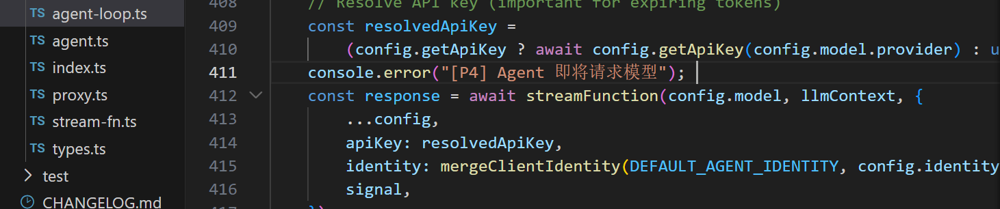

*图 1 新增的 `[P4] Agent 即将请求模型` 位于 `await streamFunction` 正上方，行号可见。*

### 2.2 在工具结果加入上下文后打印日志

在第 284 行下方插入，日志写在 `for` 循环内，每写入一条工具结果打印一次：

```ts
				for (const result of toolResults) {
					currentContext.messages.push(result);
					console.error("[P4] 工具结果已加入上下文"); // 新增
					newMessages.push(result);
				}
```

截图 S2（`for` 循环、`push(result)` 与新增日志连续可见）：

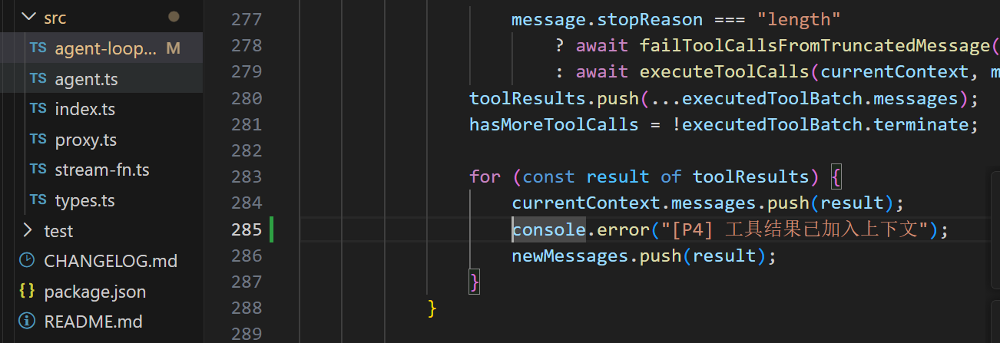

*图 2 第 283 行 `for (const result of toolResults)`、第 284 行 `currentContext.messages.push(result);`、第 285 行新增日志。*

改完用 `git diff` 确认只有这两行新增，`dist` 下的文件一律不动（下次构建会覆盖）。

---

## 三、任务二：重新编译并启动

在仓库根目录执行构建：

```powershell
npm run build
$LASTEXITCODE
```

构建会按包顺序串行执行，其中 `ai` 包会刷新模型目录数据，本次实际输出 `Total tool-capable models: 1696`、`Reasoning-capable models: 1458`，并列出各 provider 明细，属正常现象。完整过程按顺序截成四张。

截图 S3-1（根目录执行 `npm run build`、根脚本 11 个包的串行命令、前三个子包开始构建）：

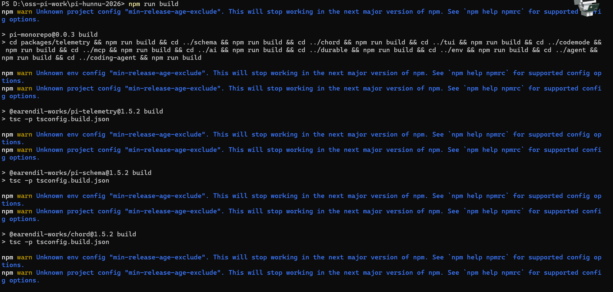

*图 3 `cd D:\oss-pi-work\pi-hunnu-2026` 后执行 `npm run build`，npm 打印根脚本里 11 个包的串行命令，`telemetry`、`schema`、`chord` 依次开始构建。*

截图 S3-2（前段子包与 `ai` 包开始抓取模型目录）：

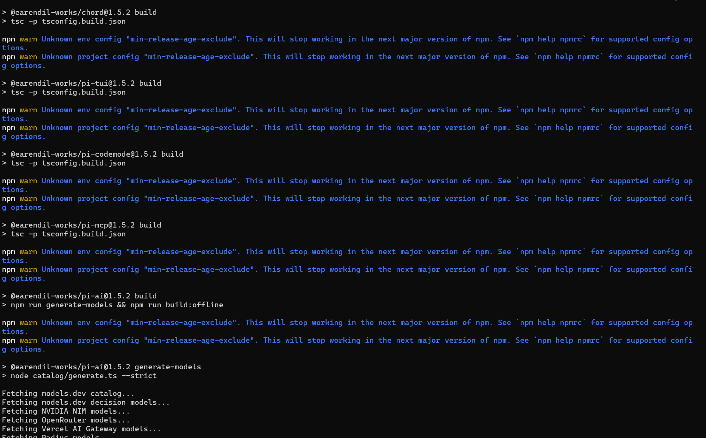

*图 4 `chord`、`tui`、`codemode`、`mcp` 构建完成，进入 `ai` 包的 `generate-models`，开始 `Fetching models.dev catalog …`。*

截图 S3-3（模型目录统计）：

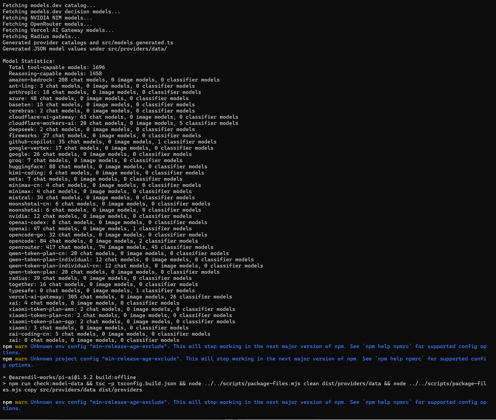

*图 5 本次构建实际统计为 `Total tool-capable models: 1696`、`Reasoning-capable models: 1458`，并列出各 provider 明细，随后 `ai` 包进入 `build:offline` 编译。*

截图 S3-4（模型数据校验、末段构建、退出码与启动命令）：

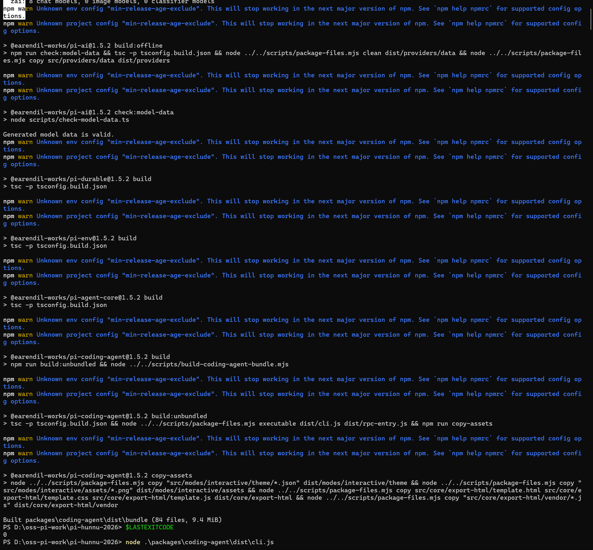

*图 6 `check-model-data` 输出 `Generated model data is valid`，`durable`、`env`、`agent` 依次构建，`coding-agent` 执行 `build:unbundled` 与 `copy-assets`，末行 `Built packages\coding-agent\dist\bundle (84 files, 9.4 MiB)`，`$LASTEXITCODE` 为 `0`，随后执行 `node .\packages\coding-agent\dist\cli.js`。*

```powershell
node .\packages\coding-agent\dist\cli.js
```

截图 S4（未打包入口启动后的界面）：

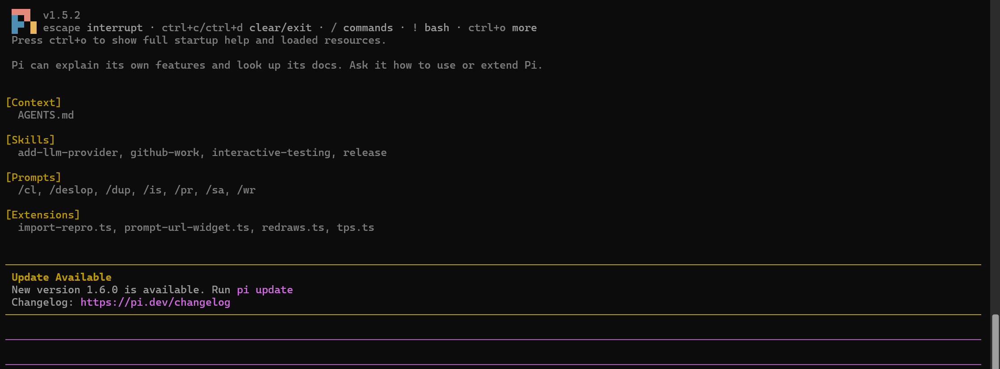

*图 7 界面标题为 `v1.5.2`，载入 `AGENTS.md`、4 个 Skills、7 个 Prompts、4 个 Extensions，与仓库源码版本一致。*

**为什么不用 `pi` 和 `pi-test.bat`**：本机全局安装的 `pi` 是 1.5.0，直接敲 `pi` 启动的是旧版本，证明不了本次改动生效；`.\pi-test.bat` 走的是 `src/cli.ts` 源码入口，虽然也会带上新日志，但本任务要验证的是「重新编译后的产物」，所以按作业要求用 `dist\cli.js`。另外 `dist\bundle\cli.js` 是打包后的发布形态，同样不适合用来对应「未打包编译产物」。

---

## 四、任务三：对比两次运行

### 4.1 准备实验文件

```powershell
cd D:\oss-pi-work\pi-hunnu-2026
New-Item .\practice4.txt -ItemType File -Force | Out-Null
Set-Content .\practice4.txt -Value "P4-20261123-01" -Encoding utf8
```

文件里只写实验代号 `P4-20261123-01`，两次会话的指令里都不直接写出代号。

### 4.2 会话 A：直接问答（A 记录）

- **输入指令原文**：`请直接用一句话解释什么是 Git 分支。`
- **是否调用工具**：没有。界面里没有 `read` 之类的工具记录，模型直接给出答案。
- **`[P4]` 日志（按出现顺序）**：只有 1 条——`[P4] Agent 即将请求模型`；没有出现「工具结果已加入上下文」。
- **最终回复原文**：「Git 分支是一条独立的开发线，指向某个提交（commit）的可移动指针，让你在不影响主线的同时并行开发或试验新功能。」

截图 S5（会话 A 的指令、回复与唯一一条日志）：

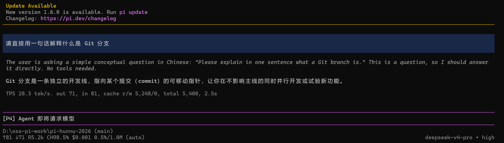

*图 8 指令下方紧接唯一一条 `[P4] Agent 即将请求模型`；回复即上面引用的那句话。状态栏模型为 `deepseek-v4-pro • high`。*

### 4.3 会话 B：读取文件（B 记录）

- **输入指令原文**（只给文件名，代号留在文件里）：``请用 `read` 工具读取当前目录的 `practice4.txt`，并告诉我文件中的实验代号。``
- **是否调用工具**：是，一次 `read practice4.txt`。模型先回复「Let me read the file practice4.txt in the current directory.」，随后界面出现 `read practice4.txt` 的工具执行记录。
- **`[P4]` 日志（按出现顺序）**：共 3 条，依次为

```text
[P4] Agent 即将请求模型
[P4] 工具结果已加入上下文
[P4] Agent 即将请求模型
```

- **最终回复原文**：「文件中的实验代号是：P4-20261123-01。」

截图 S6a（会话 B 的启动命令、`read` 工具、代号回复与退出后打印的三条日志）：

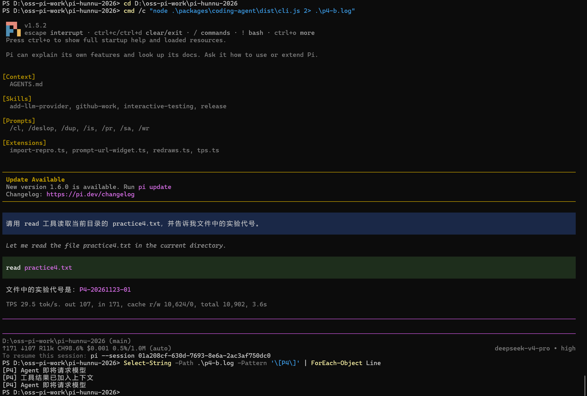

*图 9 用 `cmd /c "node .\packages\coding-agent\dist\cli.js 2> .\p4-b.log"` 启动，会话结束后执行 `Select-String -Path .\p4-b.log -Pattern '\[P4\]' | ForEach-Object Line`，按顺序打印出三条日志。*

### 4.4 日志采集方式：为什么用 `cmd /c` 重定向

Pi 界面的日志槽只保留最近两条记录。会话 B 有三条日志，最早那条「即将请求模型」被顶掉，界面里只能看到后两条（补充截图 S6b 就是这一现象）。因此改为 `cmd /c "node .\packages\coding-agent\dist\cli.js 2> .\p4-b.log"`，把子进程 stderr 直接写入文件，退出后再用 `Select-String` 过滤 `[P4]`，得到 4.3 中按顺序抄录的三条。

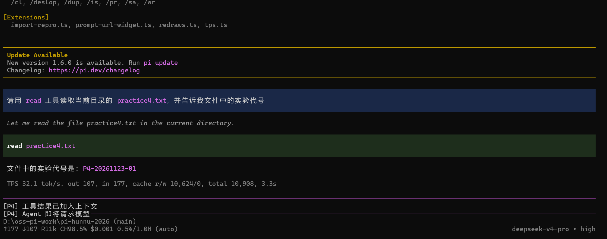

*图 10 会话 B 界面中日志槽只显示「工具结果已加入上下文」和其后的「Agent 即将请求模型」，首条已被覆盖，所以需要重定向记录。*

### 4.5 轮次说明

- **会话 A：1 轮模型调用。** 依据是只有 1 条「Agent 即将请求模型」，且全程没有工具结果日志。
- **会话 B：2 轮模型调用。** 依据是 3 条日志中「即将请求模型」出现 2 次，两次之间夹着 1 条「工具结果已加入上下文」，说明第 1 轮响应返回了工具调用、工具执行完写回上下文后，才发起第 2 轮请求。

判断方法很简单：每进入一轮模型调用前打印一次「即将请求模型」，所以「即将请求模型」的条数就是模型调用轮数；「工具结果已加入上下文」的条数就是工具结果写回上下文的次数。

### 4.6 谁读了文件，下一轮多带了什么

**谁实际读了文件**：不是模型自己。模型没有文件系统，第 1 轮它只返回一条工具调用指令（`read`，参数为 `practice4.txt`）；真正打开并读取文件的，是 `agent` 程序执行的本地 `read` 工具。B 的日志顺序「即将请求模型 → 工具结果已加入上下文 → 即将请求模型」正好对应「模型给出指令 → 程序执行工具并写回结果 → 模型看到结果再回答」。

**下一轮多带了什么**：多带了一条工具结果消息，其中包含文件名 `practice4.txt` 和文件内容 `P4-20261123-01`。这条结果由 `currentContext.messages.push(result)` 写入上下文，所以第 2 轮请求在原有对话之外还带着它，模型才能直接答出代号。这也是 B 比 A 多一轮、多一条日志的原因。


---

## 五、运行流程分析

### 5.1 两次会话对比

| 项目 | 会话 A（直接问答） | 会话 B（读取文件） |
|---|---|---|
| 指令 | 请直接用一句话解释什么是 Git 分支。 | 请用 `read` 工具读取当前目录的 `practice4.txt`，并告诉我文件中的实验代号。 |
| 是否执行工具 | 否 | 是，一次 `read practice4.txt` |
| `[P4]` 日志条数 | 1 条 | 3 条 |
| 日志顺序 | 即将请求模型 | 即将请求模型 → 工具结果已加入上下文 → 即将请求模型 |
| 模型调用轮数 | 1 轮 | 2 轮 |
| 最终回复 | Git 分支是一条独立的开发线，指向某个提交（commit）的可移动指针…… | 文件中的实验代号是：P4-20261123-01 |

### 5.2 架构简图

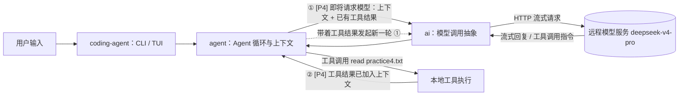

同一张图的图片版（`images/architecture.svg`，浏览器或 GitHub 中可直接查看）：

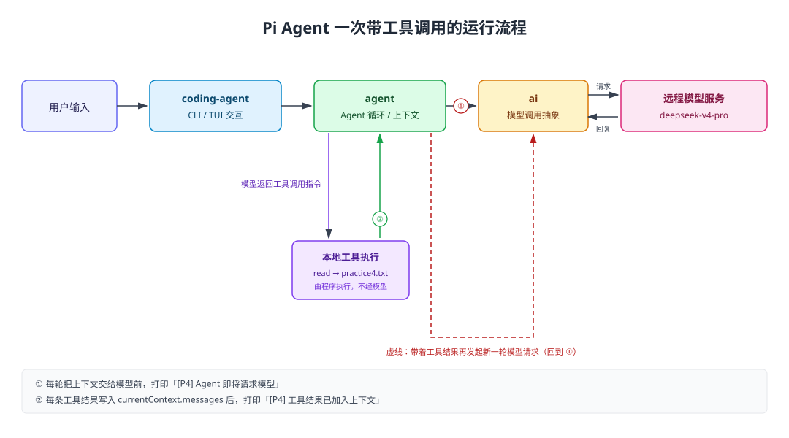

*图 11 `coding-agent` 负责交互，`agent` 维护上下文与循环，`ai` 封装模型调用，远程模型服务只返回文本与工具调用指令。① 标在 `agent` 交给模型的位置（打印「Agent 即将请求模型」），② 标在工具结果写回上下文的位置（打印「工具结果已加入上下文」）；图下方的虚线是独立回流通道，表示带着工具结果再发起新一轮请求。*

---

## 六、遇到的困难与解决过程

**1. 界面里凑不齐三条日志。** 会话 B 明明发生了「请求 → 工具 → 再请求」，可 Pi 界面的日志槽只有两行，最早那条「Agent 即将请求模型」始终看不到。一开始我以为是日志没打印，后来对比会话 A 和 B 的界面才意识到日志槽只保留最近两条记录，第三条进来就把第一条顶掉了。解决办法是不依赖界面：用 `cmd /c "node .\packages\coding-agent\dist\cli.js 2> .\p4-b.log"` 把 stderr 直接重定向到文件，退出后再用 `Select-String -Pattern '\[P4\]'` 过滤，三条日志就按时间顺序完整打印出来了。

**2. PowerShell 的 `2>>` 让日志变成一堆乱码。** 最早试的是在 PowerShell 里直接 `node ... 2>> .\p4-b.log`，结果终端不断抛出 `NativeCommandError`，日志文件里也混进了编码不一致的乱码，完全没法读。原因是 PowerShell 会把子进程写到 stderr 的内容当成错误记录再包装一层，重定向时又牵涉编码转换。换成 `cmd /c` 之后，重定向交给 cmd 处理，日志是干净的纯文本，上面的三条顺序正是这样得到的。

**3. 构建日志太长，容易误判为卡住。** `npm run build` 会先刷新模型目录数据，`ai` 包那段要打印各 provider 的模型数量，中间几十秒没有新输出。这次没有中断，等它走到 `coding-agent` 后正常结束，末行是 `Built packages\coding-agent\dist\bundle (84 files, 9.4 MiB)`，`$LASTEXITCODE` 为 0。经验是这类串行构建只要没出现 `npm error` 就继续等，判断成功要看退出码而不是看输出停了多久。

**4. 差点用错启动入口。** 一开始习惯性想直接敲 `pi`，但它指向全局安装的 1.5.0，界面能开却没有本次新增的日志。改用作业指定的 `node .\packages\coding-agent\dist\cli.js` 后，标题显示 `v1.5.2`，`[P4]` 日志也正常出现，才确认跑的是刚编译的产物。

---

## 七、心得体会

这次最直观的感受是「日志的位置就是循环的结构」。两行 `console.error` 一个放在调用模型前，一个放在工具结果入上下文后，跑起来之后 A、B 两个会话的日志条数就把 Agent 的循环讲清楚了：没有工具时只有一次请求，有工具时是「请求 → 执行 → 再请求」。以前觉得 Agent 很神秘，现在看它就是一个带 while 循环的程序，模型的输出既可能是最终答案，也可能是一条工具调用指令。

第二个体会是「谁在读文件」这个问题必须分清。模型本身没有文件系统，它只是生成 `read` 调用；真正读文件的是本地工具，读到的内容作为一条消息塞回上下文，下一轮请求才带着它去找模型。会话 B 里模型能说出 `P4-20261123-01`，不是因为模型「看到了」文件，而是因为文件内容已经在上下文里了。

第三个体会偏工程：证据的采集方式会影响结论。界面日志只留两条，如果不做重定向，我就只能凭印象写「应该是三条」，这样的报告没有说服力。而 PowerShell 的 `2>>` 又会把 stderr 包装成错误并产生乱码，换成 `cmd /c` 才拿到可核对的原文本。这件事让我意识到，观察工具本身也会影响观察结果，选一个不干扰被观察对象的记录方式很重要。

最后是对入口的理解更具体了：`dist\cli.js` 对应这次编译的产物，`pi-test.bat` 对应源码即时运行，全局 `pi` 是另一份安装。验证编译结果时必须用前者，否则改了半天源码，跑的可能还是旧版本。


