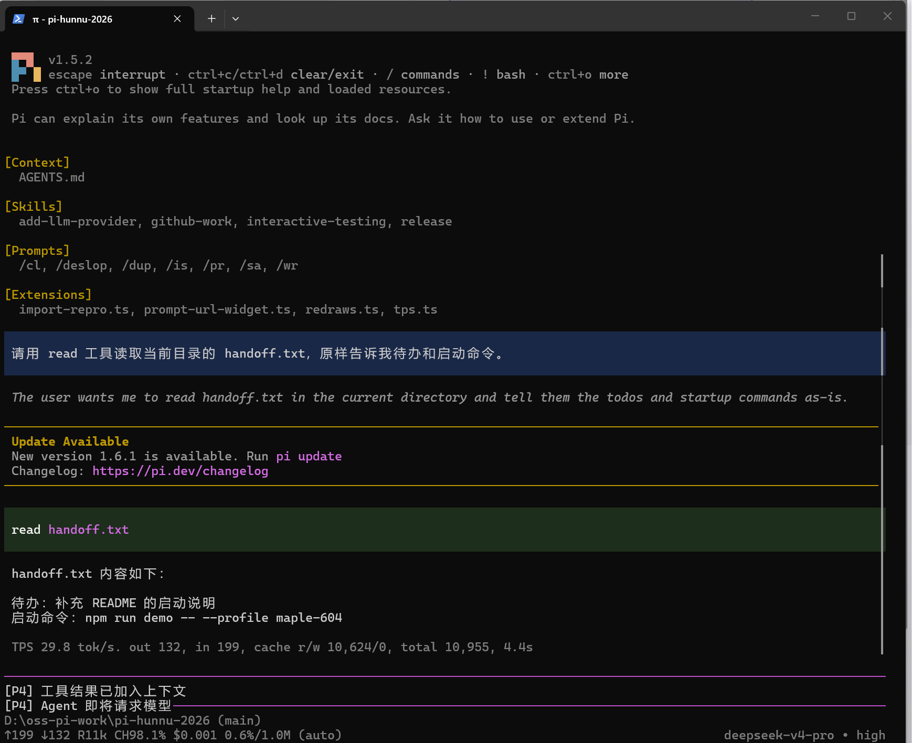
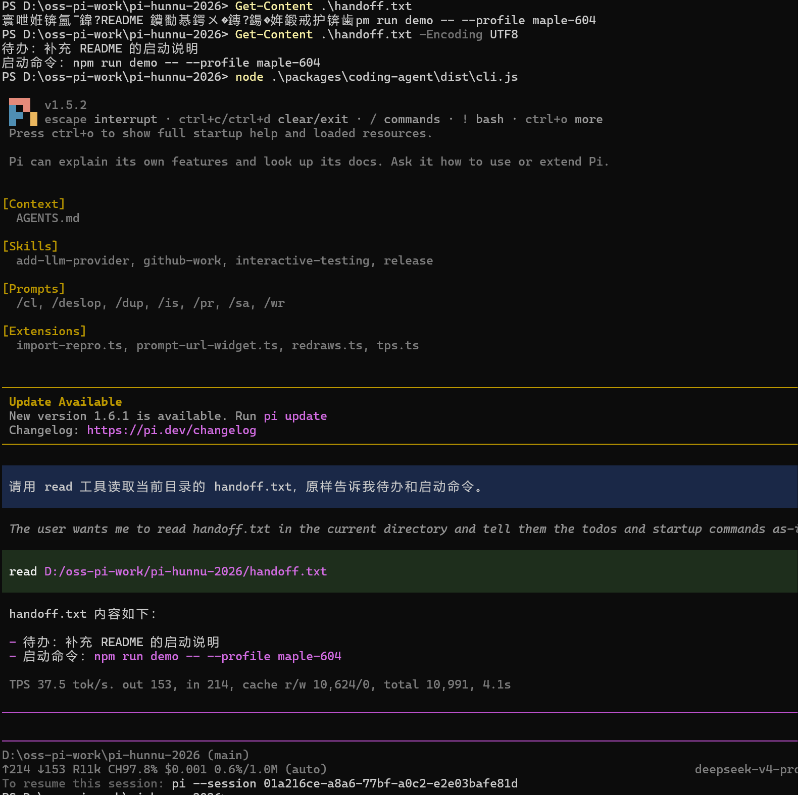
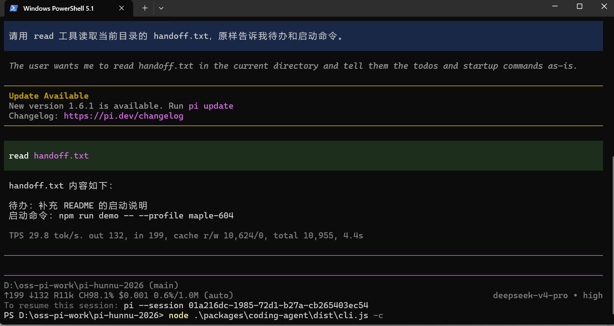
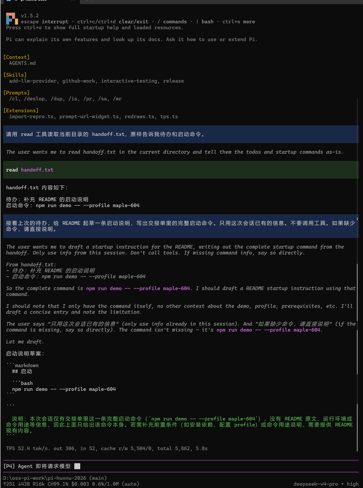
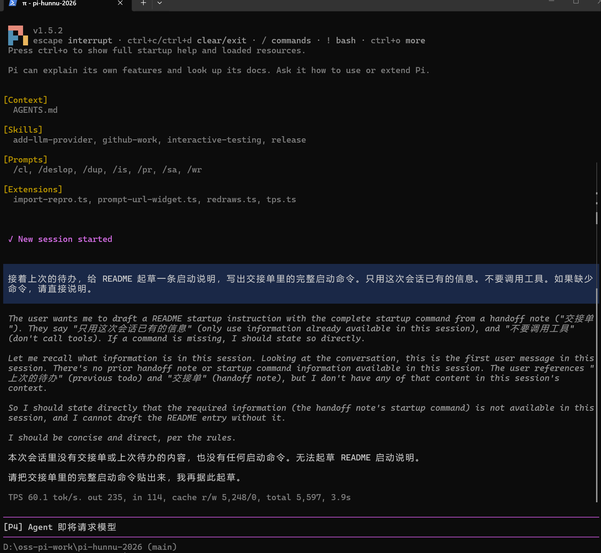
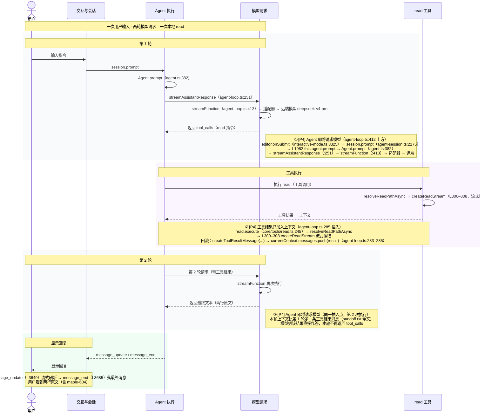
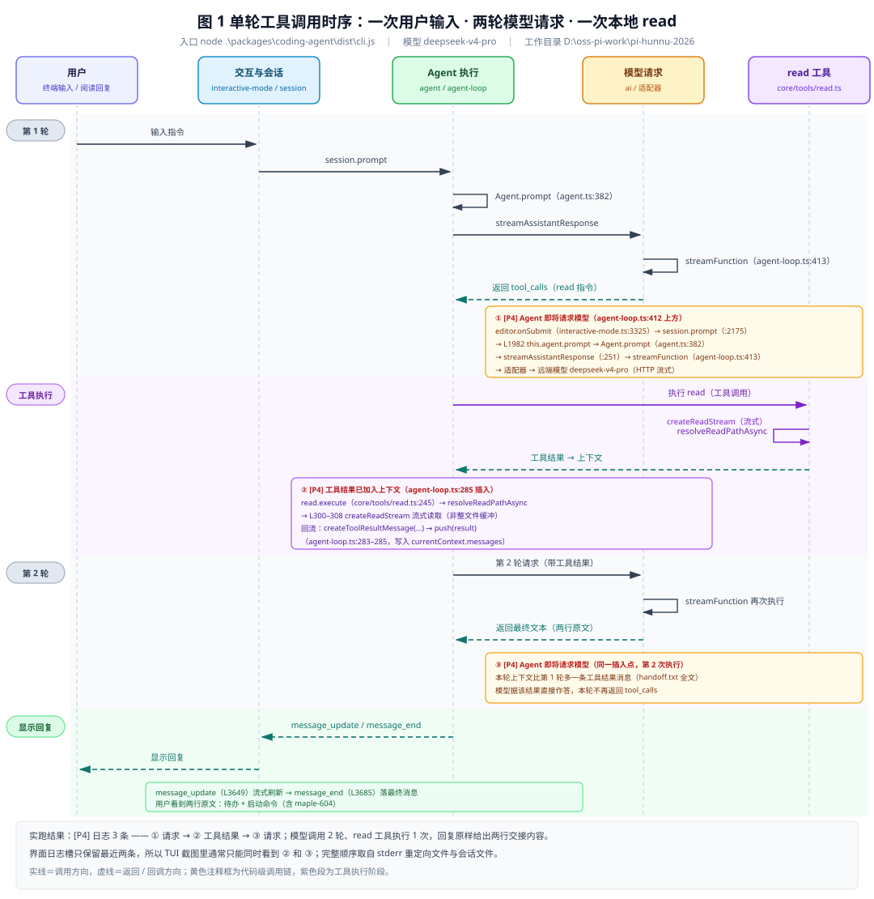
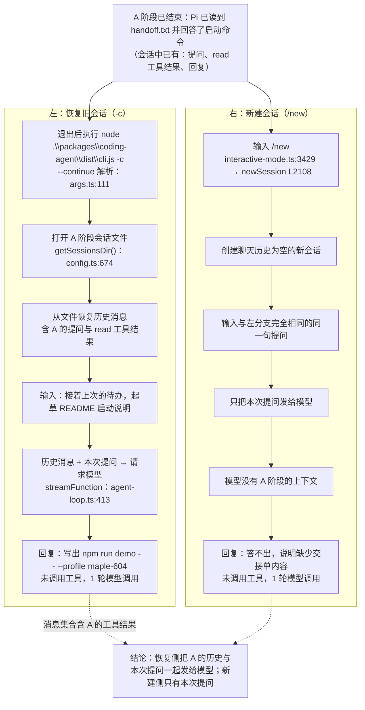
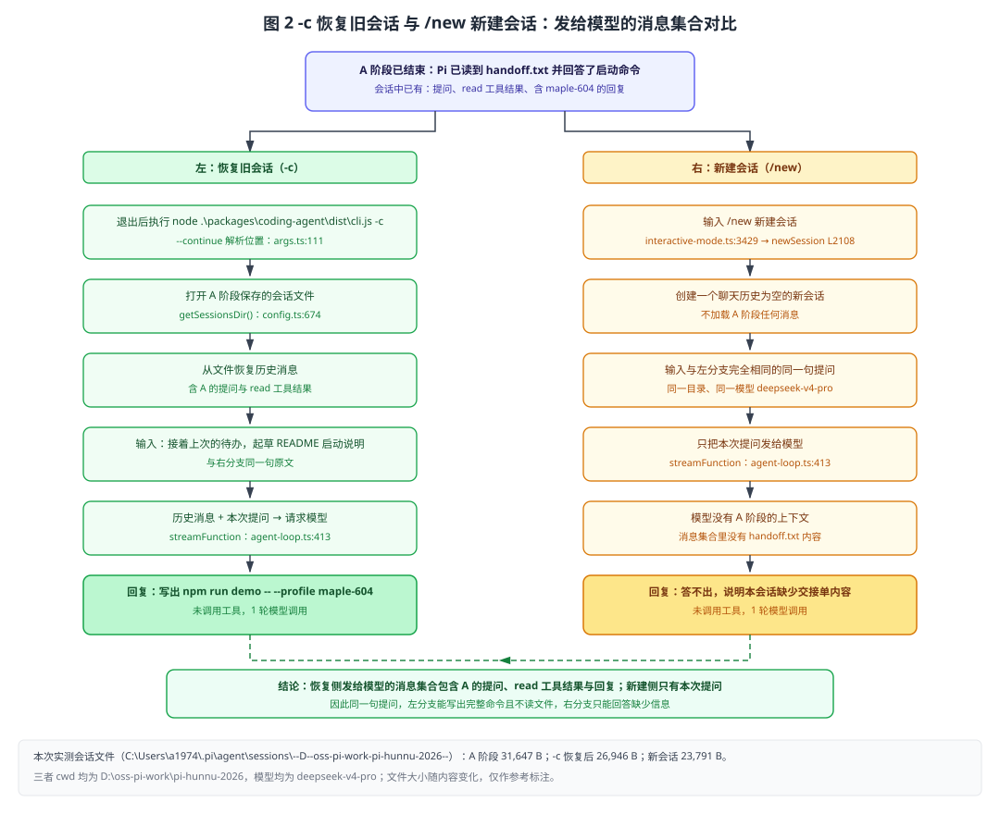

# 实践课 5：Pi Agent 工具调用与会话恢复实践报告

## 基本信息

| 项目 | 内容 |
|---|---|
| 姓名 | 杨欣华 |
| 学号 | 202430224022 |
| GitHub 登录名 | faw-k123 |
| 小组代码仓库 | https://github.com/softh-dev/pi-hunnu-2026|
| 本地仓库目录 | `D:\oss-pi-work\pi-hunnu-2026` |
| 源码提交 | `c3cc916`（分支 `main`） |
| 源码版本 | 1.5.2 |
| 本次所用模型 | `deepseek-v4-pro` |
| 运行方式 | `node .\packages\coding-agent\dist\cli.js`|
| 环境版本 | Node v24.18.0、npm 11.16.0、git 2.55.0 |

---

## 一、实验准备

### 1.1 交接文件 handoff.txt

在仓库根目录创建，只有两行：

```text
待办：补充 README 的启动说明
启动命令：npm run demo -- --profile maple-604
```

- 路径：`D:\oss-pi-work\pi-hunnu-2026\handoff.txt`
- 编码：UTF-8 无 BOM（首字节为「待」字的 `E5 BD 85`，不是 `EF BB BF`）
- 换行：LF（CR=0、LF=2），文件共 **90 字节**
- `maple-604` 是本组随机生成的标识，与实践 4 用过的代号不重复；任务 A 的提问里不出现它

### 1.2 构建产物状态

实践 4 之后 `packages/agent/src/agent-loop.ts` 又有改动（两行 `[P4]` 日志），而 `dist` 比源码旧，所以先重新编译。

根目录 `npm run build` 失败，停在 `packages/ai`：

```text
npm error workspace @earendil-works/pi-ai@1.5.2
npm error command C:\WINDOWS\system32\cmd.exe /d /s /c node catalog/generate.ts --strict
npm error Lifecycle script `build` failed with error:
npm error code 1
```

直接单独执行 `node catalog/generate.ts --strict` 后可见根因是拉取 models.dev 模型目录时 `BodyTimeoutError: Body Timeout Error`（`UND_ERR_BODY_TIMEOUT`）。`packages/ai/src/providers/data` 下的模型缓存已经存在（44 项），所以改为**分两个包单独构建**：

```powershell
cd D:\oss-pi-work\pi-hunnu-2026\packages\agent
npm run build          # 退出码 0，dist\agent-loop.js 更新

cd D:\oss-pi-work\pi-hunnu-2026\packages\coding-agent
npm run build          # 退出码 0
```

`coding-agent` 末行输出 `Built packages\coding-agent\dist\bundle (84 files, 9.4 MiB)`。两个包都是 `EXITCODE=0`，产物包含本次两行日志。

---

## 二、任务 A：单轮交互与工具调用

### 2.1 执行方式

A 阶段跑了两次同一句提问：一次在 TUI 里手动输入（截图 S1a、S1b），一次用 print 模式把 stderr 完整重定向到文件（TUI 日志槽只保留最近两条，拿不到三条完整日志）。两次回复一致，`read` 都只执行 1 次。

```powershell
cd D:\oss-pi-work\pi-hunnu-2026
node .\packages\coding-agent\dist\cli.js
# 或 print 方式（用于完整采集日志）
node .\packages\coding-agent\dist\cli.js --print "请用 read 工具读取当前目录的 handoff.txt，原样告诉我待办和启动命令。" 1> .\p5-a-out.txt 2> .\p5-a-err.txt
```

提问原文（不含 `maple-604`）：

```text
请用 read 工具读取当前目录的 handoff.txt，原样告诉我待办和启动命令。
```

### 2.2 实际观察

- `read` 工具执行：**1 次**，参数为 `handoff.txt`
- 模型调用：**2 轮**
- 回复原文：

```text
handoff.txt 内容如下：

- 待办：补充 README 的启动说明
- 启动命令：npm run demo -- --profile maple-604
```

- `[P4]` 日志顺序（来自 stderr 重定向文件）：

```text
[P4] Agent 即将请求模型      ← 第 1 轮请求
[P4] 工具结果已加入上下文     ← read 结果写回上下文
[P4] Agent 即将请求模型      ← 第 2 轮请求
```

判定依据：日志里「即将请求模型」出现 2 次，中间夹 1 次「工具结果已加入上下文」，说明第 1 轮模型返回了工具调用指令，工具执行并写回结果后才发起第 2 轮；每轮请求前只打印一次该日志，所以条数即轮数。

截图 S1a（TUI 会话：提问、read 记录、回复两行、两条 `[P4]`）：



*图 1 提问下方出现 `read handoff.txt`，回复原样给出两行含 `maple-604`；底部日志槽显示「工具结果已加入上下文」和「Agent 即将请求模型」两条，首轮那条已被顶掉。*

截图 S1b（命令行 + 提问 + read + 回复）：



*图 2 上方是 `Get-Content .\handoff.txt -Encoding UTF8` 与 `node .\packages\coding-agent\dist\cli.js`，可与图 1 互补证明启动方式。*

### 2.3 回答原文提出的问题

- **请求由谁发**：`streamFunction`（`packages/agent/src/agent-loop.ts:413`）经 `ai` 包的适配器向远端模型服务发出 HTTP 流式请求，模型只返回文本与工具调用指令，不接触文件系统。
- **read 是流式还是缓冲**：文本整文件读取走**流式**。`read.execute`（`packages/coding-agent/src/core/tools/read.ts:245`）在 `isStreamableRange` 成立时调用 `createReadStream` + `selectLinesFromStream`（L300–308）；`fsReadFile` 缓冲路径只在没有 `createReadStream` 或区间异常时兜底。
- **用户在哪看到回复**：`interactive-mode.ts` 的 `message_update`（L3649）流式刷新，`message_end`（L3685）落最终消息后由 TUI 渲染。

---

## 三、任务 B：恢复会话与新建会话

### 3.1 恢复旧会话（-c）

```powershell
cd D:\oss-pi-work\pi-hunnu-2026
node .\packages\coding-agent\dist\cli.js -c
```

启动后能看到 A 阶段的聊天记录（含那次 `read handoff.txt`）。随后输入原文：

```text
接着上次的待办，给 README 起草一条启动说明，写出交接单里的完整启动命令。只用这次会话已有的信息。不要调用工具。如果缺少命令，请直接说明。
```

- 是否调用工具：**否**（日志里只有 1 条「即将请求模型」，没有工具结果日志）
- 是否写出完整命令：**是**，`npm run demo -- --profile maple-604`
- 回复摘录：

```text
## 启动
在项目根目录运行：
npm run demo -- --profile maple-604
说明与限制：
- 完整启动命令是 npm run demo -- --profile maple-604（来自 handoff.txt）。
- 本次会话中缺少以下信息……
```

截图 S2a（`-c` 命令行）：



*图 3 上方是 A 阶段结束时的回显，最底部一行是 `PS D:\oss-pi-work\pi-hunnu-2026> node .\packages\coding-agent\dist\cli.js -c`。*

截图 S2b（恢复后的会话）：



*图 4 恢复后仍能看到 A 阶段的提问、`read handoff.txt` 与含 `maple-604` 的回复；B 的提问与回复紧随其后，底部只有 1 条 `[P4] Agent 即将请求模型`，无工具调用记录。*

### 3.2 新建会话（/new）

在同一个 TUI 里执行 `/new`，然后输入与 3.1 **完全相同**的那句话。

- 是否调用工具：**否**
- 是否写出完整命令：**否**
- 回复原文：

```text
本次会话里没有交接单或上次待办的内容，也没有任何启动命令。无法起草 README 启动说明。

请把交接单里的完整启动命令贴出来，我再据此起草。
```

截图 S3（新会话）：



*图 5 只截到 `✓ New session started` 提示、同一句提问与答不出的回复，**`/new` 那一行输入本身没有入镜**，底部状态栏的模型行也被裁掉。这一点据实说明，不影响「新会话没有 A 阶段历史」的结论。*

### 3.3 会话文件佐证

会话目录 `C:\Users\a1974\.pi\agent\sessions\--D--oss-pi-work-pi-hunnu-2026--`，三份文件的 cwd 均为 `D:\oss-pi-work\pi-hunnu-2026`，模型均为 `deepseek-v4-pro`：

| 会话 | 文件大小 | 说明 |
|---|---|---|
| A 阶段 | 31,647 B | 含提问、`read` 工具调用与两轮请求 |
| `-c` 恢复后 | 26,946 B | 在 A 的历史基础上追加本次问答 |
| `/new` 新会话 | 23,791 B | 历史为空，只有本次提问与回复 |

### 3.4 结论

恢复会话能写出 `maple-604` 且全程没有调用工具，说明它使用的是从会话文件恢复的历史消息；新建会话对同一句提问答不出，说明它的消息集合里没有 A 阶段读到的内容。两份会话的差异不在模型，而在上下文。

---

## 四、图 1 与图 2

### 4.1 图 1：单轮工具调用时序



图片版：[fig1-sequence.svg](images/fig1-sequence.svg)



*图 6 五条生命线、四个阶段（第 1 轮 / 工具执行 / 第 2 轮 / 显示回复）；实线为调用方向，虚线为返回与回调方向，黄色注释框给出代码级调用链与 ①②③ 三条 `[P4]` 日志位置。*

### 4.2 图 2：-c 恢复与 /new 新建对照



图片版：[fig2-session-compare.svg](images/fig2-session-compare.svg)



*图 7 两分支从同一个起点出发；左分支多出「读会话文件 → 恢复历史」两步，底部结论说明两侧发给模型的消息集合差异，并附三份会话文件的实测大小。*

---

## 五、遇到的困难与解决过程

**1. 根目录构建在 models.dev 上超时。** 执行 `npm run build` 时，前面几个包都正常，到 `packages/ai` 的 `catalog/generate.ts --strict` 直接失败，退出码 1，报 `BodyTimeoutError: Body Timeout Error`（`UND_ERR_BODY_TIMEOUT`）。原因不是断网——`https://models.dev` 首页返回 200——而是该脚本拉取完整模型目录时连接被中途掐断。解决办法是不再走「全量生成」，检查 `packages/ai/src/providers/data` 已有 44 项缓存后，改为单独构建真正改过的两个包：`packages/agent` 与 `packages/coding-agent`，两者退出码都是 0，bundle 仍为 84 files / 9.4 MiB，产物包含本次的两行日志。

**2. PowerShell 把子进程 stderr 包装成 NativeCommandError。** 用 `node ... 2> err.txt` 采集日志时，文件里混进了 `所在位置 行:18 字符: 1`、`+ CategoryInfo : NotSpecified ...`、`+ FullyQualifiedErrorId : NativeCommandError` 这些内容，真正的 `[P4]` 行被夹在中间。原因是 PowerShell 把原生程序写到 stderr 的内容当成错误记录再次包装。解决方式是改用 `cmd /c "node ... 1> out.txt 2> err.txt"`——但当前执行环境屏蔽了 `cmd /c`，最终改为读取文件后用正则过滤 `\[P4\]` 行，只取原始日志。结果：三条日志顺序完整，回复原文从 stdout 文件读取，没有 PowerShell 包装。

**3. `Get-Content` 默认按 GBK 解码，中文乱码。** 打开重定向出来的 `.p5-a-err.txt` 时，`[P4] 工具结果已加入上下文` 显示成 `[P4] 宸ㄥ?缁堟灉宸插姞鍏ヤ笂涓嬫枃`，`Get-Content .\p5-a-out.txt` 的回复也整段乱码。原因是文件是 UTF-8，而 PowerShell 5.1 默认按系统 ANSI（GBK）解码。解决：读取时显式加 `-Encoding UTF8`（或先 `chcp 65001` 把控制台切到 UTF-8），中文立即恢复正常。结果：后续所有日志与回复都按 UTF-8 读取，报告中的引文与文件内容逐字一致。

---

## 六、心得体会

这次第一次真正把「一轮对话」和「多次模型调用」分开看。以前总觉得问一句就是请求一次模型，跑完 A 才发现 read 这种工具会让一次提问变成两轮请求：第一轮模型只决定「调用什么工具、参数是什么」，第二轮才看到文件内容并作答。日志条数就是最直接的证据，比凭印象描述可靠得多。

第二个感受是「会话」其实是磁盘上的文件，不是内存里的神秘状态。`-c` 之所以能接上上次的话题，是因为它先打开对应项目的会话文件、把历史消息读回来，再和本次提问一起发出去；`/new` 之所以答不出，是因为它的消息集合里什么都没有。两份文件大小不同（31,647 / 26,946 / 23,791 字节），是最朴素的佐证。

第三个体会来自采集证据这件小事。界面日志槽只留两条，直接截图会缺首轮请求；想重定向又先后踩到 PowerShell 包装 stderr 和 GBK 解码两个坑。最后是「重定向到文件 + 显式 UTF-8 读取 + 正则过滤」才拿到干净的三条日志。这说明观察方式本身会影响结论，先想清楚证据长什么样，再决定怎么采集。

最后是对入口和责任边界更清楚了：`streamFunction` 负责发请求，`read.execute` 负责碰文件系统，`message_update` / `message_end` 负责把结果送回界面。模型能说出 `maple-604` 不是因为它读过文件，而是因为工具把文件内容写进了上下文。


